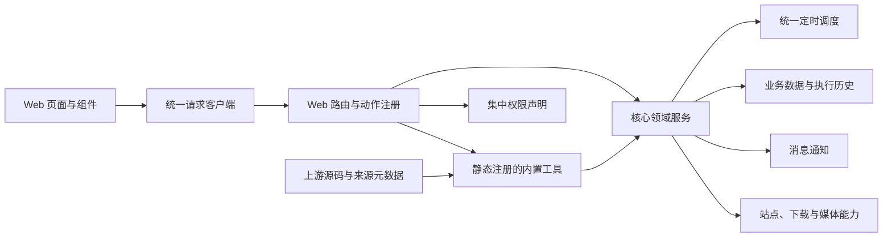

# 重构与功能整合设计

本项目采用渐进式重构：保留现有 Flask/Jinja 和核心自动化链路，先建立稳定边界，再将维护价值明确的能力纳入项目内置模块。

## 目标架构

边界约定：

- 页面只负责交互和展示，不直接拼装跨领域业务流程。
- Web 动作必须声明处理器和权限，未知动作默认拒绝。
- 新能力必须接入本项目的配置、数据库、调度器、通知和权限模型。
- 工具随项目版本静态注册和发布，不在运行时下载、扫描或加载代码。
- 外部插件必须先适配项目边界，并完整记录固定版本的上游来源。
- 只有边界清晰、维护价值明确的功能才进入主程序。

## 当前基线

- `web/permissions.py` 集中声明页面、动作和 API 权限，并通过测试检查动作与路由覆盖。
- `web/static/js/api-client.js` 统一处理请求超时、取消、网络错误、登录失效和进度条清理。
- 备份、上传、目录浏览和新业务页面采用 Flask Blueprint，逐步缩小 `web/main.py`。
- `app/tools/registry.py` 显式登记内置工具及其页面、权限和来源信息。
- `/tools` 按当前用户权限展示工具，`/tools/site-signin` 提供签到页面。
- 站点自动签到作为内置工具运行，统一使用项目的站点、配置、数据库、调度、通知和权限能力。

## 工具模块

`app/tools/` 承载面向用户的内置工具。每个工具拥有稳定 ID 和独立业务目录，静态注册表为 `/tools` 聚合页提供页面、权限和展示信息；调度任务、Web 动作及其他运行入口仍由宿主显式接入。`app/utils/` 只放无独立页面和业务状态的通用代码，两者职责不同。

### 注册约定

`ToolDefinition` 记录工具 ID、名称、描述、页面、权限、图标和顺序。项目原生工具可以不声明外部来源；从其他项目适配的工具必须通过 `ToolSource` 记录以下信息：

- `repository`：上游仓库地址；
- `path`：仓库内原始源码路径；
- `revision`：引入时固定的 tag 或 commit；
- `author`：原作者或维护者；
- `license`：上游许可证标识。

工具注册采用显式 import 和静态清单。注册表不负责统一加载或管理工具生命周期，也不下载源码、安装依赖、扫描目录、动态导入或热加载；工具依赖随项目锁文件和镜像一起交付。

### 外部适配

MoviePilot 插件只能作为上游实现参考和待适配源码。引入时需要把插件使用的配置、数据、调度、通知、事件、API 和页面接缝转换为本项目现有能力，再将结果注册为内置工具。MoviePilot 的插件市场、动态安装器、`_PluginBase` 生命周期、Vuetify JSON 页面、Vue 联邦组件和动态 FastAPI 路由不属于本项目运行时契约。

## 自动签到

站点自动签到位于 `app/tools/site_signin/`。工具负责配置、执行编排和状态展示，`app/sites/` 继续负责站点身份、连接信息与 Cookie；数据库历史、统一调度和通知渠道由宿主提供，页面入口为 `/tools/site-signin`。

当前内置能力：

- 按站点选择签到或保号登录；
- 固定时间、时间范围随机执行或按小时间隔执行；
- 同一天成功任务自动跳过；
- 失败结果按正则关键词重试；
- 并发数量限制，浏览器仿真自动串行；
- 执行结果持久化、今日状态和最近历史展示；
- 手动执行待签任务或强制全部重跑；
- 复用现有 Cookie、User-Agent、代理、浏览器仿真和通知渠道。

> 站点规则和页面可能变化，签到成功也不必然等同于站点认定的用户活跃。使用前应确认站点规则，并避免过高频率访问。

## 分阶段实施

### 自动删种筛选

[`TorrentRemovalRules`](../app/downloader/removal.py) 统一分享率、做种时长、大小、平均上传速度阈值，
以及标签交集和同数据辅种扩展。数值仍使用严格边界，0 表示关闭对应规则；路径和 Tracker 继续按不区分大小写的正则匹配。
辅种扩展仅检查同名、同大小和全部必需标签，不重新应用基础筛选条件，结果仍按扩展项在前、基础命中项在后返回。

客户端保留字段和时间适配：qBittorrent 使用实际上传量、单个 Tracker、状态和分类；Transmission
使用分享率乘以大小推算上传量、任意 Tracker、状态和错误信息。标签解析、站点描述和 ID 类型继续遵循各自客户端。
`Downloader` 负责合并用户标签与全局／任务级 NASTOOL 限制，并保持名称排序；预览和自动任务共用该入口，
暂停、删除、删除文件的执行逻辑与现有配置和接口保持不变。

### 后台调度管理

[`SchedulerManager`](../app/scheduler_manager.py) 统一持有一个 APScheduler 引擎，系统、刷流和自动删种
分别使用独立任务组及 20、10、10 个工作线程。任务 ID 按组命名，默认仍为单任务最多一个实例、
合并错过的触发以及 1 秒的迟到容忍时间。数据库任务筛选、周期计算、签到模式和手动执行入口留在原业务模块。

任务组注册完成后才激活；重复启动不叠加任务。重新加载某组只替换该组任务，保留其他组及其执行池。
稳定任务 ID 继续使用原执行器的在途计数，防止同一自动任务跨重载重入。停止会使尚未进入业务的旧队列回调失效，
已开始的操作自然结束；系统组停止等待本组在途任务，刷流和删种组保留不等待的行为。

任务成功或异常后的数据库 Session 清理由实际工作线程的 `finally` 执行，不依赖完成事件的派发线程。
进程退出时由 `run.shutdown_system()` 最后统一关闭共享调度引擎；单组停止不能关闭其他组。
这一清理边界覆盖 APScheduler 任务，不替代签到内部线程池或手动任务线程各自的资源管理。

### 配置热加载

[`Config`](../config.py) 只负责配置读写和原子落盘；运行时的 Web 保存与文件监听共用
[`ConfigReloader`](../app/config_reload.py)。协调器串行应用变更，比较最后成功生效的快照，
相同内容不重复刷新，不使用固定时间的忽略窗口。读取失败保留旧配置；部分应用失败时保留待重试字段，
再次保存相同配置或恢复旧配置都会修复相关运行状态。配置写入和所有服务的变更并非跨服务事务。

| 配置范围 | 应用边界 |
|---|---|
| 下载器选择、管理范围、排序与目录 | 刷新下载属性；连接配置变化时仅淘汰对应下载器的连接缓存 |
| TMDB 与识别选项 | 替换下载和搜索服务持有的媒体识别对象，不重建下载连接或站点 |
| 分类与缓存过期策略 | 更新分类或过期选项，保留未落盘的媒体缓存 |
| 签到业务选项与执行周期 | 业务选项直接刷新；周期变化只更新签到任务，保留其他任务计划 |
| 通知域名、Webhook 密钥 | 刷新现有客户端；必要时更新 Webhook 注册，保留轮询线程与位置 |
| Session 密钥、Secure Cookie、日志 | 原位更新 Web 设置或已创建的日志输出；更换 Session 密钥会使旧登录签名失效 |

站点、刷流、自动删种和系统字典由数据库管理，继续使用其原有更新入口；YAML 热加载不重置这些服务、
验证码、进度、统计缓存或虚拟显示。按请求读取的搜索并发、英文名优先、API Key 等无需额外刷新。
新增持久化配置时，先检查是否存在长期缓存，再更新协调器中的字段依赖和相关回归测试。

### 领域拆分

[`web/action.py`](../web/action.py) 保留 81 个动作的显式注册、`action()` / `api_action()` 响应适配、
消息任务协调及现有公开调用入口，具体处理交给 `web/actions/` 中的四个领域服务：

| 模块 | 职责 |
|---|---|
| `search.py` | 搜索、结果分组、媒体识别、探索与媒体缓存 |
| `download.py` | 添加和控制下载、下载器与预设、下载历史、自动删种 |
| `sites.py` | 站点配置、资源与统计、Cookie、验证码和刷流任务 |
| `system.py` | YAML 与系统设置、用户、通知渠道、消息、日志和重启 |

领域服务复用现有应用服务，构造时只接收共享数据库助手等依赖；搜索中的近期下载直接复用下载领域的查询。
搜索结果各层分组统一创建，下载控制共用 ID 校验和结果转换，站点能力与列表遮罩统一组装，
通知渠道保存和连接测试共用凭据保留、字段校验及错误响应。各下载入口仍保留自己的成功／失败通知行为。
URL、磁链、文件路径和配置输入规则集中在 `validation.py`，原 `web.action` 辅助函数导入路径继续可用。
Web 与 API 的既有响应字段、HTTP 路由及权限检查入口不变；模块归属不决定权限，跨领域授权仍由
`web/permissions.py` 声明。回归检查同时核对动作全集、重复注册和权限覆盖，避免拆分后漏检。

`web/main.py` 的页面蓝图拆分继续作为后续阶段，保持现有 URL。

### Web 组件化

保留服务端渲染外壳，逐页移除内联 `onclick`、重复 Ajax 和字符串拼接 HTML。公共状态统一为加载、空、成功、失败和无权限；长任务返回任务状态并由页面轮询更新。

### 工具演进

后续从 MoviePilot 或其他项目选择能力时，按以下顺序评估：

1. 是否能复用现有领域服务；
2. 是否有明确配置、权限、错误和数据边界；
3. 上游 revision、作者、许可证和依赖是否可审计；
4. 是否会修改核心数据或引入不必要的运行时风险；
5. 是否能够独立验证、升级和回滚。

优先整合消息增强、维护任务、元数据扩展和站点辅助功能。核心搜索、媒体识别、下载目录匹配和下载管理继续保留在主程序，不通过工具覆盖核心实现。

## 质量门槛

- 新增 Web 动作必须同步进入权限覆盖检查。
- 工具 ID 必须唯一；外部来源工具必须填写完整来源元数据并固定 revision。
- 配置和上传接口必须在服务端执行权限与输入校验。
- 网络错误必须区分超时、HTTP 状态、Cookie 失效和站点防护，日志不得输出 Cookie。
- 长任务需要防止重复并发执行，并保留可核对的执行结果。
- 每个阶段至少执行 Python 语法检查、模板解析、JavaScript 语法检查、权限覆盖检查和 `git diff --check`。
